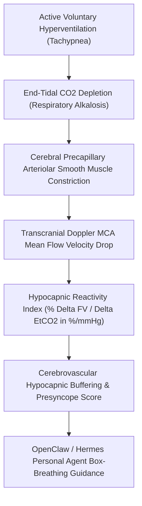

# Cerebrovascular Hypocapnic Hyperventilation Reactivity Skill

[](LICENSE)
[](https://www.python.org/)
[](requirements.txt)
[](mcp_server.py)
[](SKILL.md)

Zero-dependency sovereign personal agent skill for non-invasive evaluation of Transcranial Doppler (TCD) Hypocapnic Vasomotor Reactivity (CVR_hypo in %/mmHg), flow velocity drop, and respiratory alkalosis buffering.



## Features
- **Deterministic Math**: Pure Python standard library implementation with zero external dependencies.
- **Neurovascular Standards**: Implements validated equations for TCD MCA velocity, end-tidal CO2 shift, and hypocapnic vasoconstriction index.
- **Panic Attack & Hyperventilation Lightheadedness Shield**: Early detection of hyper-reactive cerebral vasospasm predisposing to dizziness.
- **Model Context Protocol (MCP)**: Native JSON-RPC tool integration for LLMs and autonomous agents.

## Quickstart

```python
from client import CerebralHyperventilationReactivityClient

client = CerebralHyperventilationReactivityClient()
result = client.evaluate_hypocapnic_reactivity(
    baseline_etco2_mmhg=40.5,
    hyperventilation_etco2_mmhg=26.0,
    baseline_mca_velocity_cm_s=64.0,
    hyperventilation_mca_velocity_cm_s=41.5
)
print("CVR Hypo Index:", result["cvr_hypocapnic_pct_per_mmhg"], "%/mmHg")
print("Buffer Score:", result["hypocapnic_buffer_score"])
print("Classification:", result["classification"])
```

## License
Apache-2.0
